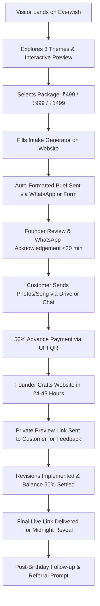

# EVERWISH — BUSINESS STRATEGY, POSITIONING & CONVERSION ARCHITECTURE
**Document Version:** 1.0.0  
**Role:** Principal Digital Strategist & Service Design Architect  
**Brand:** Everwish (`everwish.in`)  
**Founder Model:** Solo Founder / Human-Curated Boutique Side Hustle  
**Monthly Revenue Target:** ₹5,000 – ₹20,000  

---

## 1. Single-Sentence Value Proposition
> **"Everwish transforms your shared memories, private words, and favorite music into an intimate, cinematic birthday website that evokes happy tears and remains a cherished keepsake forever."**

---

## 2. Target Audience Motivations, Triggers & Objections

| Dimension | Romantic Partners (Dating, Married, Long-Distance) | Best Friends (Close Friends, Soulmates, College Pals) | Siblings & Family (Parents, Sisters, Brothers, Mentors) |
| :--- | :--- | :--- | :--- |
| **Core Emotional Motivation** | Deep romantic intimacy, vulnerability, proving how deeply they are cherished beyond superficial gifts. | Celebration of shared history, nostalgia, inside jokes, "unfiltered chaos" and lasting loyalty. | Reverence, gratitude, emotional milestone honoring (e.g. 50th, 60th), family unity across distances. |
| **Typical Purchase Triggers** | • Upcoming birthday (often planned 2–7 days in advance or panicked at 24 hours).<br>• Need for something emotional when physical gifts feel generic.<br>• Long-distance relationship needing a midnight virtual moment. | • Group birthday milestone (18th, 21st, 25th, 30th).<br>• Wanting to out-gift everyone with a hilarious and touching throwback tribute.<br>• Friend group pooling memories together. | • Golden or Silver Jubilee milestone (50th, 60th, 70th).<br>• Children living in different cities/countries wanting to collate family greetings.<br>• Retiring parent or sibling leaving home. |
| **Common Objections & Hesitations** | *"Will it feel cheesy or like an AI template?"*<br>*"Are our private couple photos and notes safe from the public?"*<br>*"What if I need it delivered right at 12:00 AM tonight?"* | *"Is it too expensive for a casual birthday?"*<br>*"Can I put funny roasts and meme photos without it looking tacky?"*<br>*"Is it easy for them to open on an iPhone or Android?"* | *"Will my non-tech-savvy dad or mom know how to open it?"*<br>*"Can we embed audio blessings from relatives who can't attend?"*<br>*"Will the link stop working after a few days?"* |
| **Conversion Resolution** | Guarantee private, unindexed URLs; personal human curation of music and photos; rush 12h delivery option. | ₹499 Starter price point; interactive photo reveals; 100% mobile responsive touch controls. | Large editorial typography; permanent link preservation; simple one-tap audio player for family voice messages. |

---

## 3. Brand Competitive Differentiation

Rather than making unsupported, unverifiable claims (e.g., *"India's #1 birthday website maker"*), Everwish wins on four verifiable, authentic pillars:

1. **Human Design Craft vs. Automated Algorithmic Fillers:**
   Generic template makers and automated builders generate cluttered, disjointed pages with awkward photo cropping and canned text. Everwish provides **personal graphic curation by a designer** who harmonizes color tones, adjusts photo framing, and balances editorial typography.
2. **Cinematic Emotional Pacing:**
   Instead of an endless vertical scroll of random polaroids, each Everwish site is built like a short film: opening curtain/envelope reveal → synchronized soundtrack → chronological milestones → intimate interactive widgets (scratch cards, sealed letters) → grand midnight wish finale.
3. **Friction-Free Direct Founder Service:**
   No software subscriptions, no confusing account signups, no watermarked ads. The customer talks directly with the creator over WhatsApp, sharing photos as casually as texting a friend.
4. **Permanent Digital Keepsake Architecture:**
   No third-party ads, no popups, no expired trial countdowns. Delivered as an ultra-fast, static link that can be bookmarked for years, revisited on anniversaries, or printed as a physical QR code inside a gift card.

---

## 4. Messaging Hierarchy

```
                    ┌─────────────────────────────────────────────────────┐
                    │                    MAIN HEADLINE                    │
                    │   "A personal birthday website they will remember   │
                    │                  for a lifetime."                   │
                    └──────────────────────────┬──────────────────────────┘
                                               │
                    ┌──────────────────────────▼──────────────────────────┐
                    │                 SUPPORTING HEADLINE                 │
                    │ "Turn your shared photographs, favorite songs, and  │
                    │ heartfelt words into a bespoke, cinematic website.  │
                    │    Delivered private and ad-free in 24–48 hours."   │
                    └──────────────────────────┬──────────────────────────┘
                                               │
           ┌───────────────────────────────────┼───────────────────────────────────┐
           │                                   │                                   │
┌──────────▼──────────┐             ┌──────────▼──────────┐             ┌──────────▼──────────┐
│ PRIMARY CALL TO ACT │             │ SECONDARY CTA       │             │ 3 CONCRETE BENEFITS │
│ "Create a Surprise" │             │ "Preview 3 Themes"  │             │ 1. 100% Human Coded │
│ (Direct Intake/WA)  │             │ (Interactive Demo)  │             │ 2. 24–48h Delivery  │
└─────────────────────┘             └─────────────────────┘             │ 3. Private Keepsake │
                                                                        └──────────┬──────────┘
                                                                                   │
                                                                        ┌──────────▼──────────┐
                                                                        │ TRUST ARCHITECTURE  │
                                                                        │ Transparent Pricing │
                                                                        │ Zero Advance to Chat│
                                                                        │ Revisions Included  │
                                                                        └─────────────────────┘
```

- **Main Headline:** *"A personal birthday website they will remember for a lifetime."*
- **Supporting Headline:** *"Turn your shared photographs, favorite songs, and heartfelt words into a bespoke, cinematic web experience. Delivered private and ad-free in 24–48 hours."*
- **Primary Call to Action (High Intent):** *"Create a Surprise"* → scrolls to frictionless intake form or launches WhatsApp chat.
- **Secondary Call to Action (Browsing Intent):** *"Preview The 3 Themes"* → opens the live interactive canvas switcher.
- **Three Concrete Benefits:**
  1. *Hand-Crafted Pacing:* Professionally aligned photos, typography, and mood-matched background music.
  2. *Guaranteed 24–48h Turnaround:* Dependable delivery for your planned celebration (with express rush availability).
  3. *Zero Bloat & 100% Private:* No third-party advertisements, no registration walls, and unindexed secure URLs.
- **Trust-Building Anchors:**
  - Clear introductory pricing (₹499, ₹999, ₹1,499) with no hidden fees.
  - Zero advance payment required to discuss the brief and receive initial layout guidance.
  - One round of revisions included before final midnight delivery.

---

## 5. Package Specification & Solo-Founder Feasibility

| Dimension | Starter Keepsake (₹499) | Personalized Story (₹999) — *Hero Tier* | Grand Heirloom (₹1,499) — *VIP Tier* |
| :--- | :--- | :--- | :--- |
| **Positioning** | Quick surprise digital midnight card. | Our signature narrative experience (most popular). | Complete bespoke production for milestone birthdays. |
| **Photo Limit** | Up to **8 photos** | Up to **20 photos** | Up to **40 photos** + 2 video embeds |
| **Audio/Music** | 1 Background Song (Spotify/MP3 sync) | 1 Background Song + Voice Note Embed | Full audio sync + multiple family voice clips |
| **Interactive Features** | Subtle entrance reveal, personal letter block, responsive grid | Interactive sealed wax envelope, memory timeline, polaroid reveal cards | Interactive quiz/reasons cards, countdown to midnight, custom URL slug |
| **Revisions** | 1 round of text/photo tweaks | 2 rounds of design & pacing revisions | Priority 1-on-1 revision consultation |
| **Delivery Time** | **24 hours** from media receipt | **24–48 hours** | **48 hours** |
| **Hosting & Access** | Hosted active for **6 months** (extendable) | Hosted active for **1 year** | **Lifetime permanent hosting** + offline archive zip |
| **Founder Time Investment** | **35–45 minutes** | **60–80 minutes** | **120 minutes** |

> **Founder Capacity Model:** At 4–8 orders per week, total founder time is approximately 4–8 hours weekly, yielding **₹5,000–₹12,000 net profit** with virtually zero infrastructure costs (hosted on free static tiers such as Vercel/Cloudflare Pages).

---

## 6. End-to-End Customer Journey



1. **Discovery (Minutes 0–2):** Visitor lands on site, immediately understands what Everwish is from the hero headline, and toggles between the 3 themes (Romantic, Playful, Family).
2. **Intent & Selection (Minutes 2–4):** Visitor checks the package table, chooses a package (e.g. ₹999 Personalized), and fills out the 5-field intake form (Names, Date, Music, Notes).
3. **Frictionless Connect (Minute 5):** Form converts the input into a ready-to-send WhatsApp payload. Customer taps *"Send to WhatsApp"* without signing up or creating an account.
4. **Founder Confirmation & Media Drop:** Founder acknowledges receipt, verifies target delivery deadline, sends UPI payment link (50% booking deposit, 50% on approval), and provides a private Google Drive folder or accepts media directly via WhatsApp.
5. **Crafting & Staging (Hours 12–36):** Founder builds the tailored page using modular components, tunes photo quality, and uploads to a private staging URL (`everwish.in/review/sample-id`).
6. **Review & Approval:** Customer reviews the staging link on their own phone, requests adjustments if needed, and approves.
7. **Delivery & Midnight Reveal:** Final clean link (`everwish.in/happy-birthday-name`) is delivered with guidance on how to send at midnight or present via QR code.
8. **Follow-Up:** Founder messages the customer the afternoon after the birthday to ask how the surprise was received and gently requests permission to feature anonymized feedback.

---

## 7. Direct Objection Handling & Honest FAQ

| Customer Objection | Honest, Transparent Studio Answer |
| :--- | :--- |
| *"Why should I pay ₹999 when I can make a free card or use a template?"* | "Free templates require hours of frustrating formatting, slap third-party advertisements on your gift, and look generic. With Everwish, you get a dedicated human designer who curates your photos, syncs music with elegant transitions, and delivers a polished, ad-free digital keepsake that feels like a luxury gift." |
| *"Are our private photos, messages, and memories safe?"* | "Yes, 100%. Your website is published on an unindexed, obscure web link that cannot be found via search engines. We never sell data, never display advertisements, and never share your photos or private notes publicly without explicit written consent." |
| *"What if I need it tonight for a midnight surprise (under 12 hours)?"* | "We offer express rush delivery whenever our schedule permits. Send us a message on WhatsApp first to check today's rush availability. If we cannot deliver before your midnight deadline, we will tell you honestly before taking any payment." |
| *"Will the website look broken on my partner's iPhone or friend's Android?"* | "Every single Everwish website is rigorously tested across iOS, Android, tablets, and desktop browsers. Images load quickly even on mobile 4G/5G connections, and touch gestures (such as tapping to open wax envelopes) work natively." |
| *"How long will the link remain active?"* | "Starter websites remain live for 6 months, Personalized for 1 year, and Grand Heirloom for lifetime permanent access. You also receive an offline archive so your memories are never lost." |

---

## 8. Minimal Lead-Generation Funnel for Solo Founder

```
[ Top of Funnel ]
• Instagram Reels / TikTok Shorts: Screen recording of the "Midnight Reveal" (unfolding wax envelope with music playing).
• Word-of-Mouth / Post-Celebration Link Footer: Every finished website has a discreet, elegant "Handcrafted by Everwish" credit at the bottom.
• WhatsApp Status Updates & Friends Network during launch month.
                          │
                          ▼
[ Middle of Funnel — Landing Page ]
• everwish.in (Vite/React static on Vercel/Cloudflare)
• Clear value prop → Live 3-Theme Switcher → Transparent ₹499/₹999/₹1,499 pricing.
• Immediate visual reassurance: No fake reviews, clear turnaround commitments.
                          │
                          ▼
[ Bottom of Funnel — WhatsApp Intake ]
• Interactive form compiles brief → Customer clicks to WhatsApp.
• Founder responds within 30 minutes with personalized voice note or text.
• Closes order with 50% UPI deposit.
```

---

## 9. Measurable Launch Metrics & Health Indicators

*Note: In accordance with Rule 4 & 9, these are structural tracking metrics for validation, not fabricated vanity baselines.*

1. **Qualified Enquiry Volume:** Target: **15–30 qualified inquiries per month**. (Defined as: visitor fills the intake brief and clicks through to WhatsApp).
2. **Enquiry-to-Paid-Order Conversion Rate:** Target: **25%–40%**. (Out of 20 WhatsApp chats, converting 5–8 customers into paid orders).
3. **Average Order Value (AOV):** Target: **₹850 – ₹1,100**. (Driven by the ₹999 Personalized package as the primary anchor).
4. **On-Time Delivery Rate:** Target: **100%**. Every site delivered at least 4 hours before the customer's midnight deadline.
5. **Referral / Virality Coefficient:** Target: **1 referral for every 3 delivered websites**, driven by the recipient or celebration attendees seeing the live link.

---

## 10. Proposed Site Map & Prioritized Backlog

### Proposed Information Architecture (Site Map)
1. **Global Header:** Brand seal monogram (`E`), Everwish Studios logo, nav anchors (Themes, Packages, Process, FAQ), "Taking Orders" status pill, "Start a Surprise" WhatsApp CTA.
2. **Hero Stage:** High-impact editorial headline, 3 trust badges (100% Human-Coded, 24–48h Turnaround, Ad-Free Keepsake), dual CTA buttons.
3. **Interactive Theme Showcase:** Live simulated viewport with 3 tabs:
   - *Romantic & Intimate*
   - *Playful & Vibrant*
   - *Warm & Family-Oriented*
4. **Transparent Package Matrix:** Side-by-side comparison of Starter (₹499), Personalized (₹999), and Grand Heirloom (₹1,499).
5. **Collaborative Process (3 Simple Steps):** Media drop → Handcrafted calibration → Midnight reveal.
6. **Illustrative Story Formats:** Demonstrating emotional reception across partner, friend, and parent relationships (clearly labeled as illustrative demo concepts).
7. **Direct Intake & Quote Brief Builder:** 5-field interactive questionnaire generating instant WhatsApp & Email payloads.
8. **Accessible FAQ Accordion:** Answering top 5 objections.
9. **Global Footer:** Legal disclosures, founder privacy commitments, direct WhatsApp/Email contacts, copyright.

---

### Prioritized Implementation Backlog

| Priority | Phase / Feature | Business & Technical Objective |
| :---: | :--- | :--- |
| **P0 (Done)** | Brand Identity & Design Tokens | Implement luxury palette (Midnight, Gold, Ivory, Rose), Google Fonts, and core CSS variables under `Everwish`. |
| **P0 (Done)** | Reusable UI Primitives | Accessible Button, Badge, Heading, Input, Select, Textarea, Skeletons, and Accordions. |
| **P0 (Done)** | Interactive Theme Previewer | 3-theme simulated canvas with wax envelope unfold and music visualizer toggle. |
| **P0 (Done)** | Pricing Package Cards | Starter (₹499), Personalized (₹999), Grand Heirloom (₹1,499) with savings and turnaround tags. |
| **P0 (Done)** | WhatsApp Brief Intake | Client-side intake generator producing pre-populated WhatsApp & Mailto links. |
| **P1 (Next)** | Media Uploader Guidance Modal | Add step-by-step guidance for customers on how to share high-res photos via Google Drive or WhatsApp without compression. |
| **P1 (Next)** | Delivery Countdown & Calendar Picker | Add interactive celebration countdown widget to preview how the birthday midnight clock works. |
| **P2 (Future)** | Sample Full-Screen Demo Pages | Standalone preview routes (e.g. `/demo/romantic`, `/demo/playful`, `/demo/family`) for visitors who want to test the full experience on their own mobile devices. |
